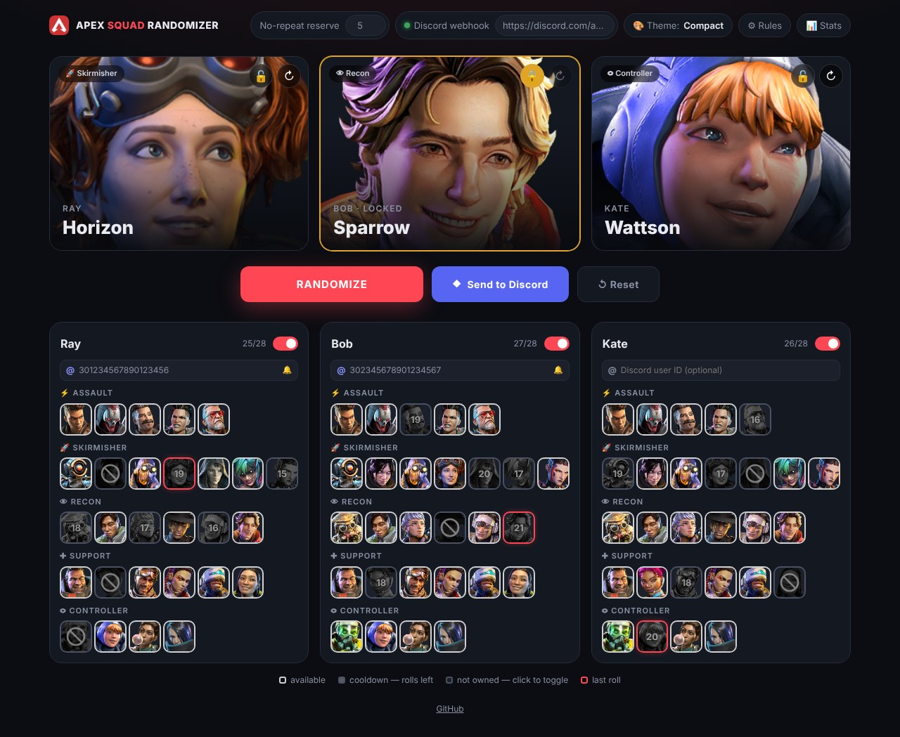
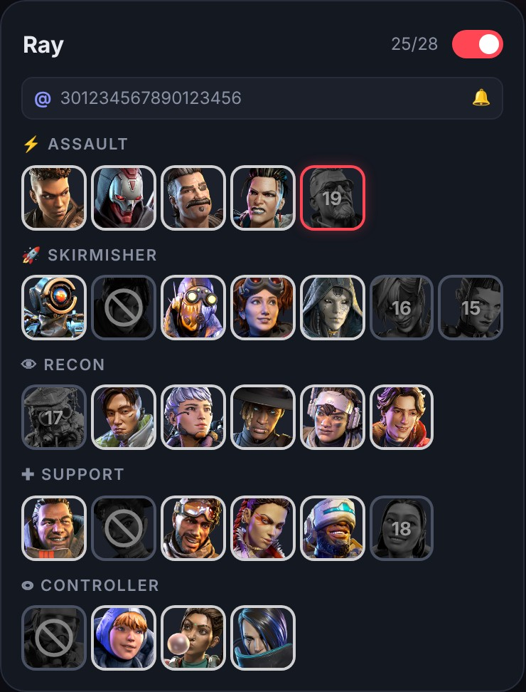
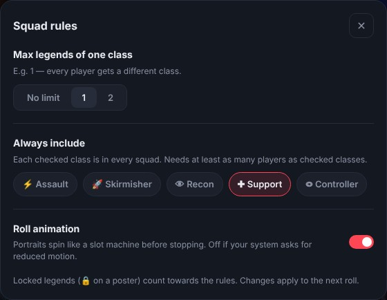
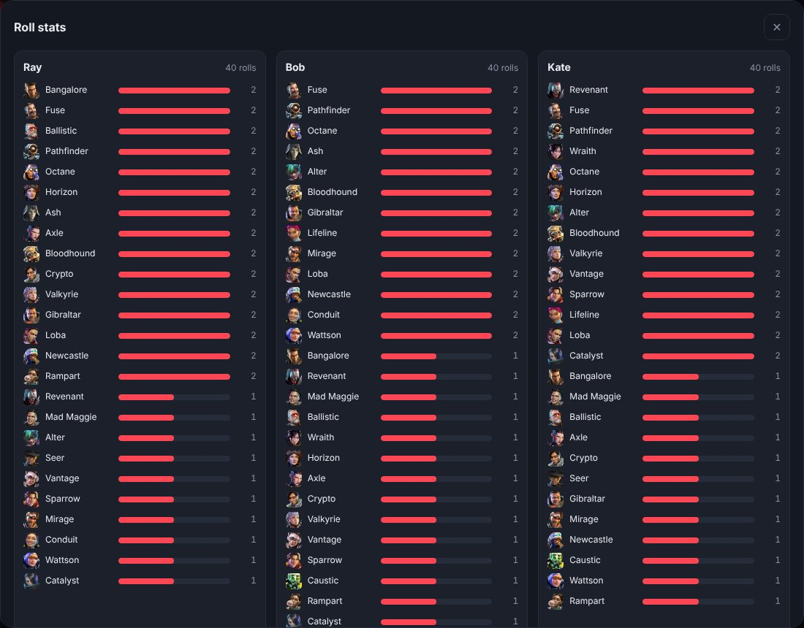
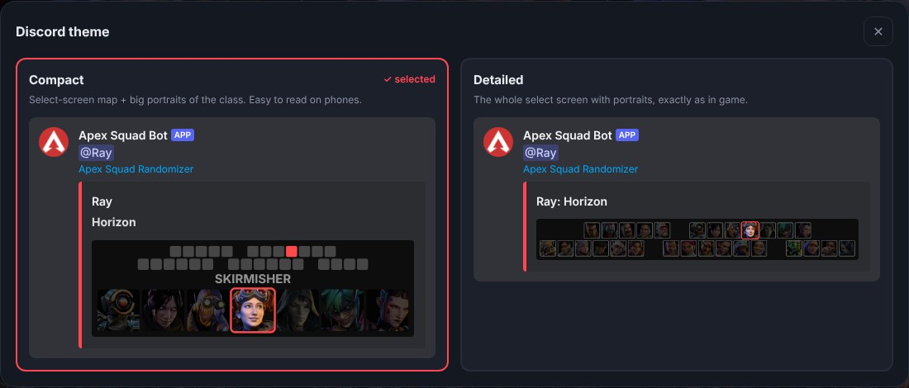
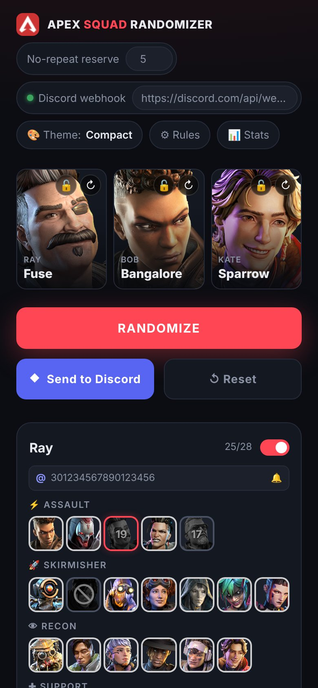

# Apex Legends Squad Randomizer

Rolls a random legend for every player in your Apex Legends squad and posts the result to Discord —
with a picture of the legend select screen, so everyone knows where to click.

**▶ Open the randomizer: https://rayderua.github.io/apex-legends-squad-randomizer/**



No build step, no backend, no dependencies — a static page that runs entirely in the browser.

## How to use

1. **Set up once:** name the players, untick the legends each player doesn't own,
   paste a Discord webhook, pick a theme and (optionally) add players' Discord IDs to ping them.
2. **Every match:** press **Randomize** → **Send to Discord**.
   Don't like one pick? **↻** on that poster rerolls only that player.

Everything is saved in the browser, so next time the page opens ready to go.

## Features

- **Up to 3 players** — rename a player right in the card header; the switch includes or excludes them.
- **Per-player legend pool** — click a portrait to mark a legend as not owned (or not wanted).
- **No duplicates in a squad** — two players never get the same legend.
- **No-repeat window** — a player won't get the same legend again too soon ([how it works](#no-repeat-window)).
- **Reroll one player** — **↻** on a poster rerolls just that player; teammates keep their legends.
- **Lock a legend** — **🔒** on a poster keeps that legend on every *Randomize* (e.g. while you're learning it).
- **Squad rules** — limit legends of one class per squad, or always include a class ([details](#squad-rules)).
- **Roll animation** — portraits spin like a slot machine before stopping (can be turned off).
- **Roll stats** — how often each legend was rolled for every player.
- **Discord webhook** — one click sends the squad with an image of the select screen; two themes to choose from.
- **Pings in Discord** — add a player's Discord user ID and they get a push notification with every squad.
- **↺ Reset** — clears the current squad, locks and cooldowns; players, legends, settings and stats stay.
- **Works on phones** — the layout adapts to small screens.
- **Saved locally** — names, Discord IDs, players, legend pools, reserve, roll history, the last squad, locks,
  rules, stats, webhook and theme live in `localStorage`.

### Legend tiles



Every portrait in a player card shows its state:

| Look | Meaning |
|------|---------|
| colour, **white** ring | available for the next roll |
| grey, number, **grey** ring | rolled recently — the number is how many rolls until it's back |
| dark, "no entry" sign, **grey** ring | the player doesn't own it — click to toggle |
| **red** ring | rolled in the last roll |

Hover a portrait to see a hint.

<br clear="right">

## No-repeat window

Each player has their own roll history. With **N** legends in a player's pool and a
**No-repeat reserve** of **R**, any **N − R** rolls in a row for that player are different legends.

| Legends in pool (N) | Reserve (R) | Different legends in a row |
|---------------------|-------------|----------------------------|
| 13                  | 5           | 8                          |
| 28 (all)            | 5           | 23                         |
| 10                  | 8           | 2                          |
| ≤ R + 1             | any         | no restriction             |

- The reserve is the number of legends that always stay available: higher means more random,
  lower means more rotation. Change it in the top bar.
- Unticking a legend doesn't break the guarantee — only legends currently in the pool are counted.
- **↺ Reset** clears the history for all players.

## Squad rules

**⚙ Rules** in the top bar (the badge shows how many rules are on):



- **Max legends of one class** — *1* gives every player a different class, *2* forbids three of a kind.
- **Always include** — every checked class is in each squad, e.g. always a Support.
  You need at least as many players as checked classes.
- **Roll animation** — on/off. It's also skipped when your system asks for reduced motion.

Rules apply to *Randomize* and to a single-player reroll; locked legends count towards them.
If no squad can fit the rules and legend pools, you get a message explaining why instead of a roll.

## Lock and reroll

Each poster has two buttons:

- **↻ Reroll** — rolls a new legend for this player only (never the same one again);
  the other players keep theirs. The rerolled-away legend wasn't played, so it doesn't go on cooldown
  and isn't counted in the stats.
- **🔒 Lock** — keeps this legend for the player on every *Randomize* until you unlock it.
  A locked poster has a gold frame; locked picks don't add cooldowns or stats.
  Unticking the locked legend in the player's card removes the lock.

## Roll stats

**📊 Stats** in the top bar shows, for every player, how many times each legend was rolled — most rolled
on top, owned legends that never came up at the bottom. Hover a row to see the share.



Stats are kept when you press **↺ Reset**; clear them with *Reset stats* in this window.

## Discord

1. In Discord: *Server Settings → Integrations → Webhooks → New Webhook*, choose a channel, *Copy Webhook URL*.
2. Paste it into the **Discord webhook** field in the top bar — the dot turns green.
3. Press **🎨 Theme** and click the look you like.
4. Roll a squad and press **Send to Discord** — it's sent right away.

### Pinging players

To make Discord notify a player when the squad is sent, put their **Discord user ID** into the `@` field
under their name:

1. In Discord: *User Settings → Advanced → Developer Mode* (once).
2. Right-click the player → *Copy User ID*, paste it into the field (a pasted `<@…>` mention works too).

A 🔔 means the ID is valid; a red field means it isn't. Only players taking part in the roll are pinged,
and only them — the message never pings `@everyone` or roles. Players without an ID are just not mentioned.
Discord only notifies people who can see the channel, and respects their notification settings.

### Themes



The theme window shows how each theme looks in Discord, with the same images and sizes,
using your last roll (or a sample legend).

| Theme | Card text | Image |
|-------|-----------|-------|
| **Compact** | player name, legend in bold | schematic of the select screen with the legend's slot in red + its class with large portraits |
| **Detailed** | `Player: Legend` | the whole select screen with portraits, the legend highlighted |

Discord shrinks images in messages to about 400px wide, so *Compact* is easier to read on phones,
while *Detailed* shows the exact in-game layout.

**Notes**

- Images are generated in the browser. When the page is opened as a local file (`file://`), browsers block
  this and the message is sent as text only — use GitHub Pages or a local server
  (`python -m http.server` in the project folder).
- The webhook URL is stored only in your browser, but anyone who has it can post to the channel —
  don't share it.
- The select-screen images follow `CONFIG.classes` and `CONFIG.selectScreenRows` in `static/js/app.js`.
  If a new season changes the in-game order, update them so the highlight points to the right slot.

## On a phone



## Project structure

```
index.html            page shell — the UI itself is rendered by app.js
static/js/app.js      everything else: config, state, randomizer, UI, Discord
static/css/style.css  styles
static/images/        legend portraits (Portrait_<Name>_square.png) and the app icon
docs/screenshots/     images for this README
```

## Adding a new legend

1. Add the name to the right class in `CONFIG.classes` at the top of `static/js/app.js`
   (in the same order as on the in-game select screen).
2. Put a square portrait into `static/images/` named `Portrait_<Name>_square.png`
   (spaces become underscores: `Mad Maggie` → `Portrait_Mad_Maggie_square.png`).

New legends are enabled for every player automatically.

## Deployment

Push to GitHub and enable *Settings → Pages → Deploy from a branch → `main` / root*.
The site is published at https://rayderua.github.io/apex-legends-squad-randomizer/

JS and CSS are loaded with a unique `?v=` parameter on every page load, so a new release is picked up
immediately — no need to rename files. Only `index.html` itself may be cached by GitHub Pages for a few minutes.

## About this project

The randomizer was originally written by hand: the idea, the first working version with player pools,
duplicate-free squads and the Discord webhook were built without AI.

Later it was polished with the help of an AI assistant (Claude by Anthropic): the no-repeat window,
the Discord images, themes and player pings, squad rules, locks and rerolls, the animation and stats, the redesign, refactoring and this README. Every change was directed,
reviewed and tested by the author.

## License

No license specified yet.